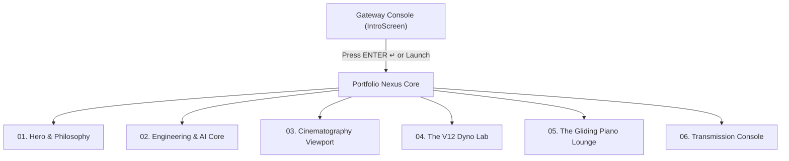

<div align="center">

# 🌌 Ayush Anand — Portfolio Nexus v2.0
### *B.Tech CSE (Artificial Intelligence & Machine Learning) • Creative Technologist • Engine Enthusiast • Pianist*

[](https://react.dev/)
[](https://www.typescriptlang.org/)
[](https://vitejs.dev/)
[](https://tailwindcss.com/)
[](https://developer.mozilla.org/en-US/docs/Web/API/Web_Audio_API)
[](https://vercel.com/)

<br />

> *"Architecting intelligent AI systems and prompt-driven applications, driven by an autonomous mindset, a passion for high-revving automobile engineering, and the acoustic expression of piano keys."*

<br />

[Explore Live Demo](https://my-portfolio-starkayush.vercel.app/) • [Direct Transmission](#-direct-communication--transmission-console) • [Technical Architecture](#-technical-architecture)

---

</div>

## 💎 Design Philosophy & Aesthetic

Inspired by the refined darkness of the **Rolls-Royce Black Badge** series, this portfolio is built with an uncompromising obsidian aesthetic (`#040407` & `#050508`), subtle carbon-fiber weave patterns, and neon ambient glows (cyan, crimson, amber, and ultraviolet).

Every interaction is engineered with intent:
- **Zero Heavy Audio Assets**: 100% of the acoustic piano notes and mechanical V12 combustion engine revs are synthesized live via the native browser **Web Audio API** mathematically at runtime. Zero `.mp3` or `.wav` overhead.
- **Fluid Micro-Interactions**: Dynamic velocity-stretching inertial cursor, smooth glissando sweeps, and real-time canvas waveform visualizations.
- **Autonomous & Decisive**: Reflecting independent problem-solving and rapid hackathon execution.

---

## 🎹 Key Modules & Interactive Compartments



### 1. 🖥️ Gateway Console (`IntroScreen`)
- **System Initialization**: Terminal typing sequence simulating identity verification and runtime environment check.
- **Scroll Isolation**: Strict document overflow locking while on the entrance screen to prevent accidental background scrolling before entering.
- **Cinematic Reveal**: Triggered seamlessly by hitting `ENTER ↵` or clicking *"Launch Experience"*, smoothly fading into the main portfolio.

---

### 2. ⚡ Core Engineering & AI
Synthesizing academic rigor with hands-on software development:
- **Artificial Intelligence & Machine Learning**: Neural network architectures, predictive modeling, data pipelines, and deep learning paradigms.
- **Python Language Mastery**: Algorithmic problem-solving, OOP architectures, data transformation, and backend prototyping.
- **Computer Systems & Architecture**: Low-level execution intuition, process scheduling, memory hierarchies, OS lifecycles, and network socket communication.
- **Modern Frontend Engineering**: React 19, TypeScript, responsive Tailwind CSS layouts, and dark luxury UI patterns.
- **Web Foundations (HTML, CSS & JavaScript)**: Semantic HTML5, CSS Flexbox/Grid architectures, and modern JavaScript DOM interaction.
- **Generative Prompting & Vercel Edge**: Rapid prototyping and continuous deployment to global edge networks.
- **Git & GitHub Workflows**: Structured commit histories, feature branches, and pull request collaborations.
- **Autonomous Mindset & Hackathon Highlights**: 2x Hackathon competitor with experience building functional prototypes within 24–48 hour sprints.

---

### 3. 🎬 Cinematography & Visual Storytelling
- **2.39:1 Anamorphic Widescreen**: Real-time cinema aspect ratio viewport with REC indicators, raw timecode counters, and subtle film grain overlay.
- **Camera Metadata HUD**: Live metadata tags showing focal lens (`35mm Anamorphic`, `85mm Prime`, `24mm Ultra-Wide`), aperture (`f/1.4`, `f/1.8`), shutter speed (`1/48s`), ISO (`320`), and framerate (`24.00 FPS RAW ProRes`).
- **Director's Note**: *"Translating human emotion and mechanical beauty into compelling visual stories through the lens of cinematography, composition, and video pacing, though it's something more than a hobby to me. The cameras, the perspectives, the beauty, the lenses, a perfect shot (which doesn't ever exist) indeed, is what I want to master on the way."*

---

### 4. 🏎️ The V12 Dyno Lab (Automobile Compartment)
- **Authentic Power Start / Stop Engine Button**: Interactive starter button with real-time combustion sound synthesis (crank phase $\to$ ignition catch $\to$ steady idling rumble).
- **Throttle Rev Limiter**: Hold to rev the V12 powertrain up to 8,500 RPM with progressive acoustic turbo-spool frequencies and exhaust pop harmonics.
- **ECU Remapping Matrices**: Real-time switchable ECU profiles:
  - **Stage 1 (Street)**: Factory balance with sharpened throttle response.
  - **Stage 2 (Sport)**: Boost pressure increase and optimized intake timing.
  - **Track / Pure Dyno**: Full aggressive torque curves, launch control, and anti-lag telemetry.
- **Automotive Diagnostics**: Component status monitoring (crankshaft, twin-scroll turbos, fuel rail, and titanium exhaust).

---

### 5. 🎹 The Gliding Piano Lounge
- **Pure Acoustic Synthesizer**: Custom multi-harmonic Web Audio sound engine:
  $$\text{Signal} = A_1 \sin(2\pi f t) e^{-t/\tau_1} + A_2 \sin(4\pi f t) e^{-t/\tau_2} + A_3 \sin(6\pi f t) e^{-t/\tau_3}$$
  - Ultra-pure fundamental frequency ($A_1 \approx 0.32$).
  - Second harmonic ($2f$, $\tau_2 = 0.45\text{s}$) adding warmth and acoustic wooden resonance.
  - Soft third harmonic ($3f$, $\tau_3 = 0.16\text{s}$) imparting natural hammer transient ping.
  - 8ms exponential attack ramp eliminating transient DC clicks.
  - Master Butterworth lowpass filter ($Q=0.707$) + optical dynamics compressor + $\tanh$ soft saturation WaveShaper preventing DAC digital clipping.
- **Gliding Glissando Interaction**:
  - Click-and-drag mouse/trackpad glissando across keys.
  - Touchscreen swipe glissando for mobile and tablet devices.
  - Page wheel scroll safety (vertical scrolling over the piano will not accidentally trigger keys).
- **Physical Keyboard Voicings**:
  - Full natural keys bound to physical keyboard (`[A, S, D, F, G, H, J, K, L]`) and accidentals (`[W, E, T, Y, U, O]`).
  - Active only when viewing the `#music` section via `IntersectionObserver`.
- **One-Touch Chord Voicings Rack**:
  - Dedicated one-touch polyphonic buttons with keybindings `[1 - 6]` for **C Major**, **G Major**, **A Minor**, **F Major**, **D Minor**, and **E Minor**.
- **Personal Reflection**:
  > *"When I’m into academics, you can usually find me in my room with a piano, giggling with the chords and the melodies that got stuck in my head at 2 a.m. the night before. Piano requires two independent hands moving in syncopated rhythms, reading patterns, and maintaining mental clarity. It's the ultimate mental exercise for a software engineer—mirroring concurrency, multithreading, and structural harmony. \"Music theory\" in itself is a completely different world, and I want to live it!"*

---

### 6. 📬 Direct Communication & Transmission Console
- **Direct Website Transmission**: Visitors can submit messages directly through the on-page console without needing any desktop email application installed (via FormSubmit AJAX integration to `starayush.in@gmail.com`).
- **Browser Webmail Shortcut**: Instant 1-click **"Open in Gmail Web"** option with recipient, subject, and message pre-filled directly in `mail.google.com`.
- **Social Connect Hub**:
  - **Instagram**: `@starkayush_` with 1-click handle copy.
  - **LinkedIn**: Verified professional profile (`ayush-anand-864582427`).
  - **GitHub**: `@starkayush` repository showcase.
  - **X (Twitter)**: `@starkayush_` technology & lifestyle updates.

---

## 🛠️ Technology Stack

| Domain | Technology / Tool | Purpose |
| :--- | :--- | :--- |
| **Core Framework** | React 19 (TypeScript) | Reactive component architecture and type safety |
| **Build Tool** | Vite 6 | Instant Hot Module Replacement (HMR) and optimized bundling |
| **Styling** | Tailwind CSS | Utility-first obsidian dark theme & responsive grids |
| **Audio Architecture**| Web Audio API (`AudioContext`) | Real-time multi-harmonic piano & V12 engine synthesis |
| **Icons & Media** | Lucide React + Bespoke SVGs | High-precision vector typography and status iconography |
| **Form Pipeline** | FormSubmit AJAX + Gmail Webmail | Reliable direct email transmission without mail clients |
| **Deployment** | Vercel Edge Network | Zero-downtime global edge distribution |

---

## 📂 Project Directory Structure

```text
portfolio/
├── public/                 # Static assets & public brand icons
├── src/
│   ├── components/
│   │   ├── CustomCursor.tsx        # Rolls-Royce Black Badge lerp gliding cursor
│   │   ├── IntroScreen.tsx         # Gateway terminal with typing effect & scroll lock
│   │   ├── Navbar.tsx              # Sticky glassmorphism header & navigation
│   │   ├── HeroSection.tsx         # Hero banner, core highlights & principle badges
│   │   ├── EngineeringSection.tsx  # Skill cards, categorization, and hackathon milestones
│   │   ├── StorytellingSection.tsx # 2.39:1 widescreen cinema viewport & camera HUD
│   │   ├── GarageSection.tsx       # V12 Dyno Lab with Power Start/Stop & RPM rev limiter
│   │   ├── PianoSection.tsx        # Interactive Gliding Piano with chords rack [1 - 6]
│   │   └── ContactSection.tsx      # Direct website email transmission & social cards
│   ├── utils/
│   │   └── audio.ts                # Pure Web Audio synthesis engine (Piano & V12 Engine)
│   ├── App.tsx                     # Main application layout, scroll lock controller
│   ├── main.tsx                    # React root entrypoint
│   └── index.css                   # Global Tailwind utilities, custom scrollbars & patterns
├── index.html                      # HTML template with luxury Cinzel typography
├── package.json                    # Dependencies & build scripts
├── tailwind.config.js              # Theme extension, custom palette & typography
├── tsconfig.json                   # Strict TypeScript compiler options
└── vite.config.ts                  # Vite build & plugin configuration
```

---

## ⚡ Getting Started Locally

### Prerequisites
- [Node.js](https://nodejs.org/) (version 18.0 or higher recommended)
- `npm` or `pnpm`

### Installation & Run

1. **Clone the repository:**
   ```bash
   git clone https://github.com/starkayush/portfolio.git
   cd portfolio
   ```

2. **Install project dependencies:**
   ```bash
   npm install
   ```

3. **Start the local development server:**
   ```bash
   npm run dev
   ```
   Open [https://my-portfolio-khaki-eight-89.vercel.app](https://my-portfolio-khaki-eight-89.vercel.app) in your browser to experience the portfolio.

4. **Build for production:**
   ```bash
   npm run build
   ```
   Generates an optimized, tree-shaken static production bundle in the `dist/` directory.

---

## 🚀 Deployment

The portfolio is optimized for instant deployment on **Vercel**:

```bash
# Deploy using Vercel CLI
npx vercel

# Or push directly to your main branch on GitHub and import the repo at vercel.com
```

---

## 👤 Author & Connect

**Ayush Anand**  
*B.Tech in Computer Science & Engineering (Artificial Intelligence & Machine Learning)*

- **Email:** [starayush.in@gmail.com](mailto:starayush.in@gmail.com)
- **LinkedIn:** [linkedin.com/in/ayush-anand-864582427](https://www.linkedin.com/in/ayush-anand-864582427)
- **GitHub:** [@starkayush](https://github.com/starkayush)
- **Instagram:** [@starkayush_](https://www.instagram.com/starkayush_/)
- **X (Twitter):** [@starkayush_](https://x.com/starkayush_)

---

<div align="center">
  <sub>Engineered with precision, passion, and code by Ayush Anand. © 2026. All rights reserved.</sub>
</div>
